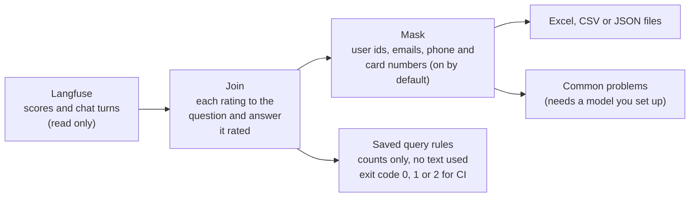
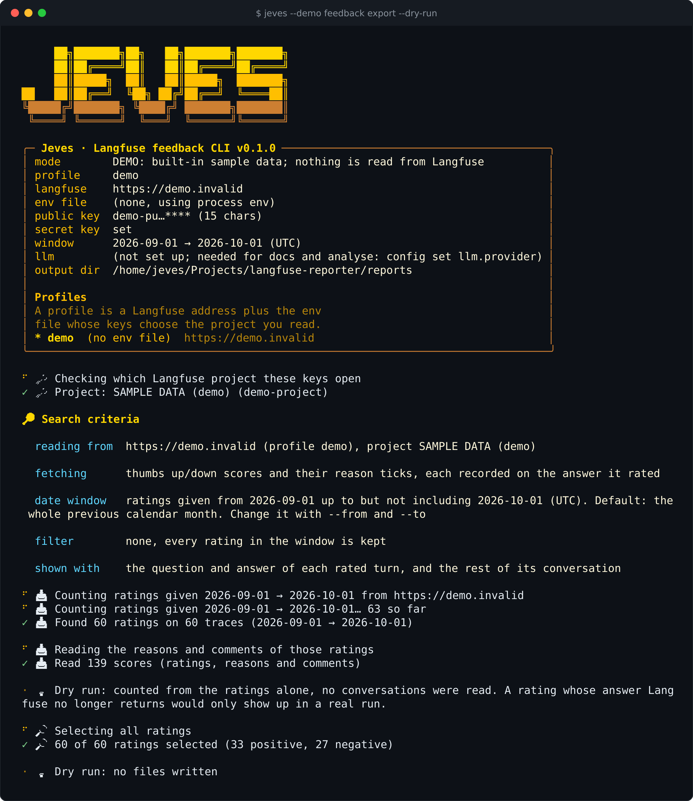
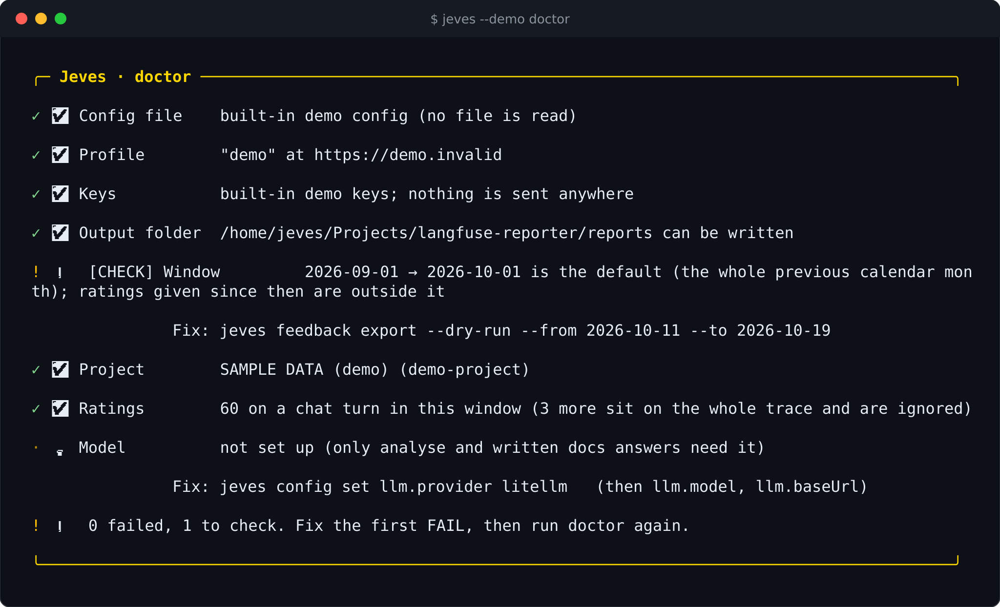
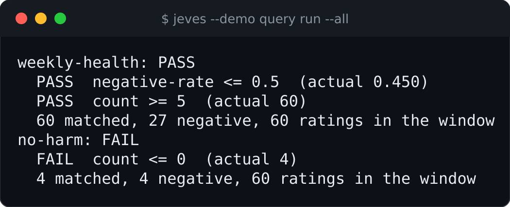
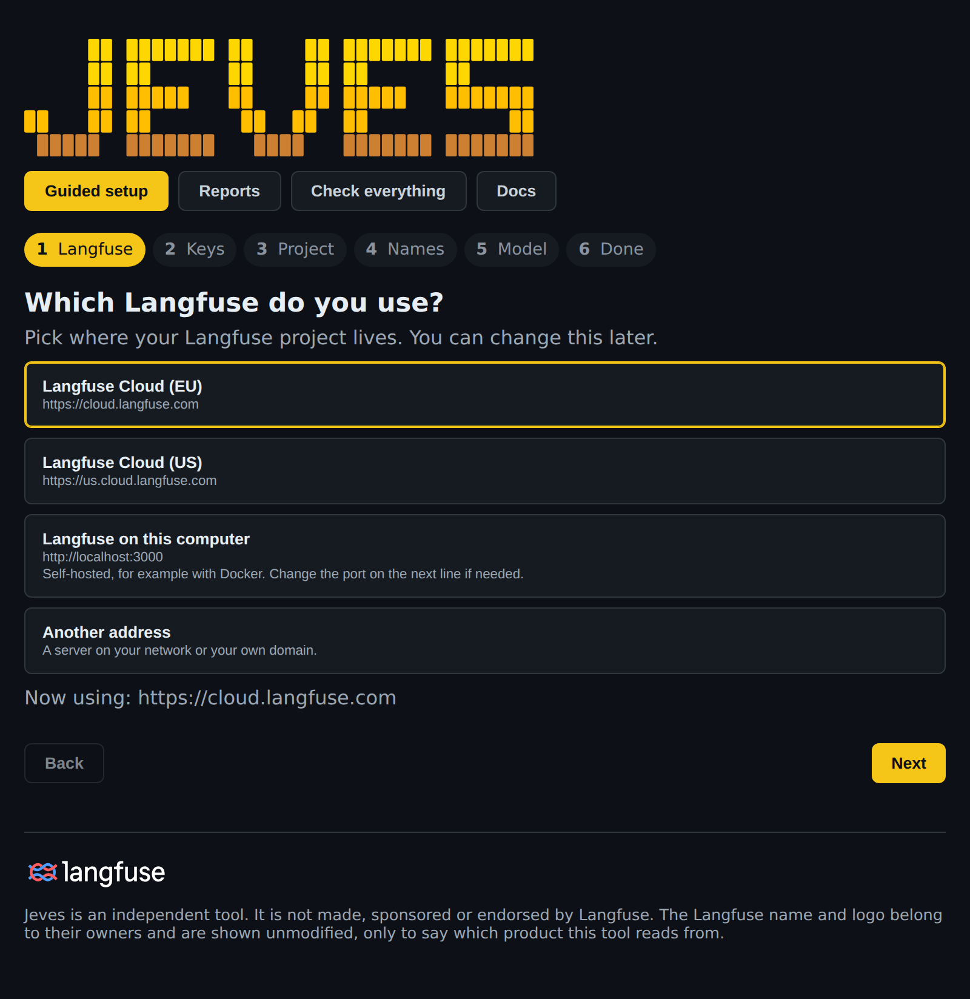
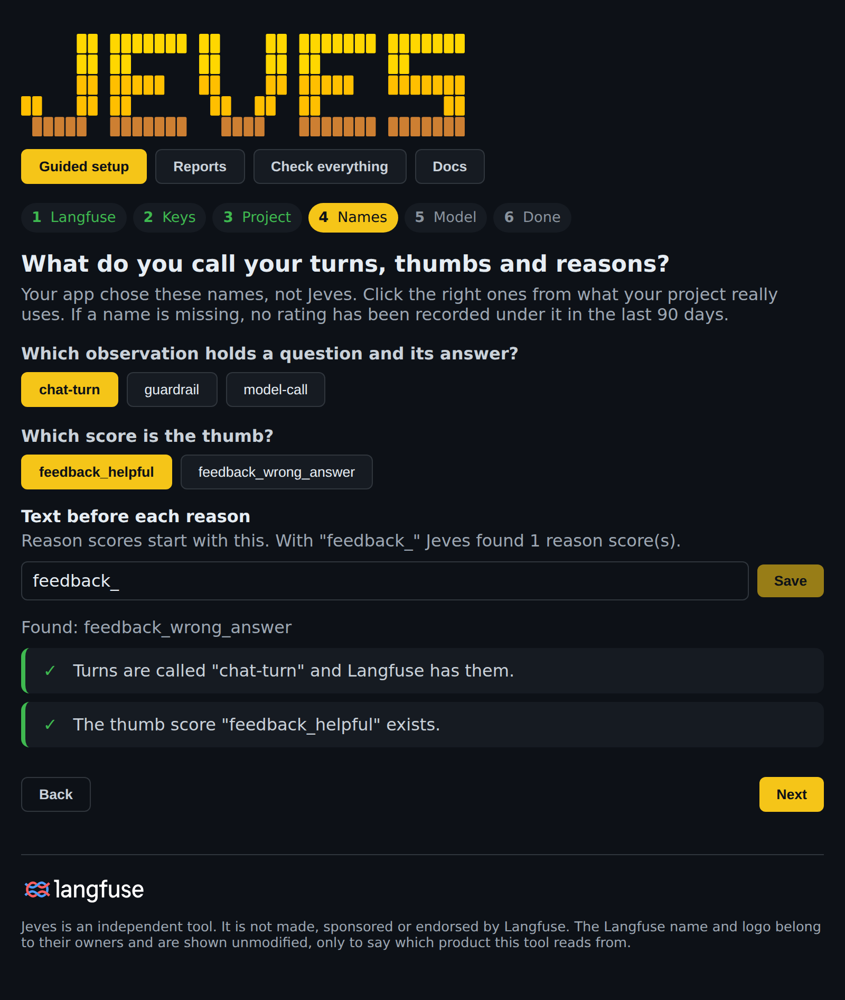
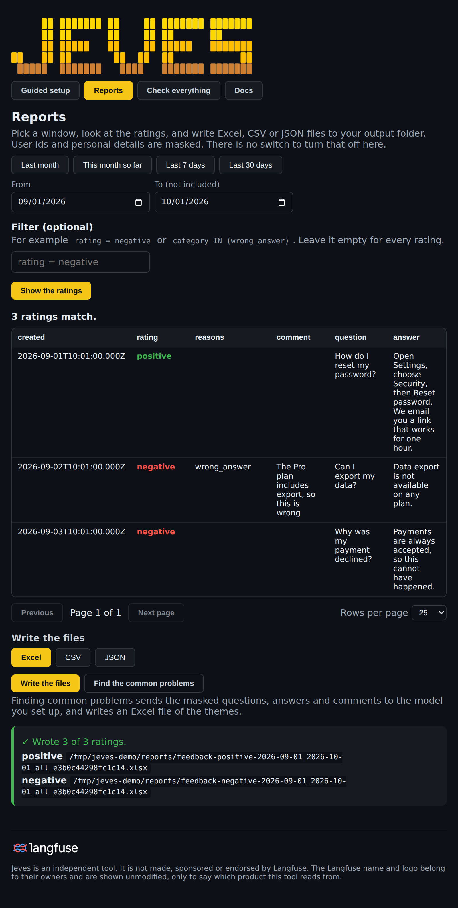
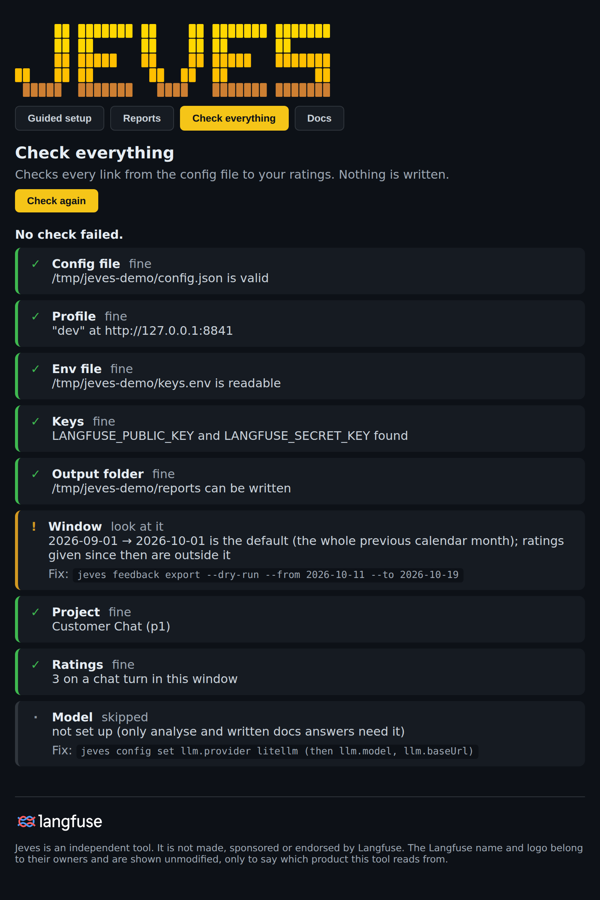

<div align="center">

<picture>
  <source media="(prefers-color-scheme: dark)" srcset="docs/images/jeves-logo-dark.svg">
  
</picture>

### Turn the thumbs your users give your AI agent into reports you can act on

A command-line reporter for [Langfuse](https://langfuse.com). It joins every rating to the exact question and answer it was given on, hides personal data, and writes Excel, CSV or JSON files. It can also fail a build when a complaint rate climbs.

[](LICENSE)
[](#install)
[](tsconfig.json)
[](#keep-the-data-safe)

<br>

<picture>
  <source media="(prefers-color-scheme: dark)" srcset="docs/images/langfuse/langfuse-wordart-white.svg">
  
</picture>

<sub>Jeves is an independent tool. It is not made, sponsored or endorsed by Langfuse. The Langfuse name and logo belong to Langfuse GmbH / Finto Technologies Inc. and are shown unmodified, only to say which product this tool reads from.</sub>

</div>

<br>

## How it works



Reading a month of feedback means opening conversations one by one. Jeves does that work: it downloads the ratings for a period, shows each one next to its question and answer with the reasons the user ticked, and writes the result in the format you need. Langfuse is only read. Nothing is written back.

## See it run

Every picture below is the real output of `jeves --demo`, which runs on built-in sample data. No Langfuse account is needed. Only one thing is changed: the folder where the tool was run is replaced with a placeholder path (`/home/jeves/...`), and long lines are wrapped at 100 columns.

**Export** counts and writes the ratings of a period. The banner states that this is demo data.



**Doctor** checks every link from the config file to the ratings, and prints the fix for each problem.



**Query run** checks the rules of saved queries and sets an exit code a pipeline can act on: 0 all rules pass, 1 a rule failed, 2 could not check.



## Quick start

Prefer clicking to typing? Run `jeves ui` instead of the steps below: it asks one question at a time and writes the settings for you.

```sh
npm install -g @icodenet/langfuse-reporter     # puts jeves on your PATH
jeves --demo doctor                            # try it on sample data
jeves --demo feedback export --format csv --out /tmp/demo
jeves --demo query run --all                   # exit code 1 here, on purpose
```

When you are ready for your own project, follow [Connect to Langfuse](#connect-to-langfuse). If your application names its turns, thumbs or reasons differently, read [Use jeves with your own Langfuse names](docs/bring-your-own-schema.md) first. Your application must record ratings the way [docs/langfuse-setup.md](docs/langfuse-setup.md) describes; every name there is a setting you can change.

## Try it without an account

`--demo` runs Jeves on built-in sample data. You need no Langfuse account, no keys and no config file, and nothing is sent anywhere. The sample is 60 invented ratings for last month, so the default window always finds them.

```sh
jeves --demo                                   # a guided check, then what to try next
jeves --demo feedback report --format json     # the sample ratings as JSON
jeves --demo feedback export --format csv --out /tmp/demo
jeves --demo analyse                           # common problems, with sample groupings and no model
jeves --demo ui                                # the browser page on the sample data
jeves --demo soul                              # a picture tour
jeves --demo query run --all                   # sample saved queries; exit code 1 on purpose
```

Some commands change your config file, and there is no file in demo mode. These are refused with a plain message: the interactive session, `config check`, `config init`, `config set`, `config use`, and saving a setting in the browser page. `compare` needs two report files that you have already written. The sample data is invented, so it shows how the tool works and not how your own project looks. When you are ready, run `jeves ui`.

## Commands

| Command | What it does |
| --- | --- |
| `jeves feedback export` | Write the ratings of a period as Excel (default), CSV or JSON, split into thumbs up and thumbs down |
| `jeves feedback report` | Read the ratings full screen, or print them as CSV or JSON |
| `jeves feedback fields` | List the filter fields, operators and valid values |
| `jeves analyse` | Ask a model for the common problems in the feedback, and write them to Excel |
| `jeves compare` | Compare two exported reports: what is still negative, what improved, what is new |
| `jeves live-vs-offline` | Compare an offline eval report with the live thumbs-down report, per risk area |
| `jeves query save, list, remove, run` | Saved queries with rules, for CI. Exit code 0, 1 or 2 |
| `jeves docs <question>` | Ask how the tool works and how Langfuse must be set up |
| `jeves ui` | Open the browser page: guided setup, then reports (a sortable table, Excel, CSV and JSON files, and the common-problems analysis) |
| `jeves config show, check, discover, schema, init, set, unset, use` | Show or change settings and profiles. `check --json` and `schema` are for scripts and editors |
| `jeves doctor` | Check every link from config to ratings, with a fix for each problem. `--json` prints the checks for a script |
| `jeves --demo ...` | Run any of the above on built-in sample data |
| `jeves` | Open the interactive session with live suggestions as you type |

Add `--help` to any command for a short card. Add `--no-mask` to `export`, `report` or `analyse` only when you need the raw text.

## Privacy by default

Exports, reports and `analyse` mask personal data before anything is written or sent to a model. User ids become short codes that change on every run. Emails, phone numbers, card numbers (checked with the Luhn test), IBANs and UK National Insurance numbers in the question, answer and comment become `[email]`, `[phone]`, `[card]`, `[iban]` and `[ni-number]`. The rules are pattern-based: names and addresses are not caught. Files are readable by their owner only. See [Keep the data safe](#keep-the-data-safe).

## The browser page

`jeves ui` opens a page in your browser for setting Jeves up and for making reports. You do not need to know the config file.

```sh
jeves ui              # prints a link and opens your browser; Ctrl+C stops it
jeves ui --no-open    # prints the link only
```

The page has four tabs.

**Guided setup** asks one plain question at a time and checks each answer as you go:
1. Which Langfuse do you use? Cloud EU, Cloud US, Langfuse on this computer (a self-hosted one, default `http://localhost:3000`, with the port editable), or another address.
2. Where are your keys? You pick the env file in a file browser, or type the folder. The page shows whether both keys were found. It never shows a key.
3. Which project did the keys open? The page shows its name so you can see you chose the right one.
4. What does your app call its turns, thumbs and reasons? The page lists the names it finds in your project, and you click the right ones.
5. A model for `analyse` and `docs`. Optional.
6. A full check.

**Reports** works once setup is green. Pick a window (last month, this month so far, last 7 or 30 days, or two dates), add a filter if you want one (the same language as `--where`), and click **Show the ratings**. The ratings appear in a table you can sort by clicking a column and page through. **Write the files** writes Excel, CSV or JSON to your output folder and lists the files. **Find the common problems** runs `analyse` and shows the themes. A run over the size limit asks you first. User ids and personal details are masked, and the page has no switch to turn that off.

**Check everything** runs `doctor` at any time.

**Docs** shows the same pages as `jeves docs` (this README, the Langfuse setup guide, the guide to your own names, the procedure for a coding agent, and every setting) with a search box. Pictures are not loaded there, because the page only loads its own files; their descriptions are shown instead.

<p>


</p>
<p>


</p>

Every picture above is the real page, running on invented sample data.

The page runs on your computer only. It answers on `127.0.0.1`, needs the random token in the link, and refuses any other host name. The file browser lists names only and never opens a file, so it cannot read a key. Every change goes through `jeves config set`, so the same rules that check the config file check every value, and the exact reason is shown next to the field. The page cannot edit a key: you edit the env file yourself.

The page is built into static files with `pnpm build:ui`. The CLI ships the built files, so installing the CLI does not install React. `pnpm e2e:ui` clicks through the setup and the Reports tab in a real browser against a fake Langfuse.

## Use it in a pipeline

Jeves runs without a terminal and never waits for an answer. A pipeline needs no config file and no env file: set the environment and run the command.

```sh
export LANGFUSE_BASE_URL=https://cloud.langfuse.com    # or your own address, such as http://localhost:3000
export LANGFUSE_PUBLIC_KEY=...                         # from your CI secret store
export LANGFUSE_SECRET_KEY=...
jeves doctor --json                                    # {failed, checks[]}; exit 1 when a check fails
jeves feedback export --format csv --json --out reports --fail-if-empty
jeves query run --all --json                           # {exit, queries[]}; exit 0, 1 or 2
```

- **`LANGFUSE_BASE_URL`** sets the Langfuse address for the run. It wins over the config file, and it is checked by the same rule (it must start with `http://` or `https://`, and it may not hold a user name or password). It is never written to the config file. The keys come from `LANGFUSE_PUBLIC_KEY` and `LANGFUSE_SECRET_KEY`, and the model key from `LLM_API_KEY`.
- **`feedback export --json`** prints one JSON object on stdout: `found` (ratings in the window), `selected` (ratings that match the filter), `positive`, `negative`, `dryRun`, `countedFromRatingsOnly` (only on a dry run: `true` when the count came from the ratings alone, so a real export may hold a few fewer rows, `false` when the conversations were read), `files` (the kind and path of each file written) and `replaced`. The progress text goes to stderr, so a pipe stays clean. With `--dry-run` it lists no files.
- **Exit codes:** 0 is success. 1 is a failure, such as a bad value, wrong keys or an unreachable server. `--fail-if-empty` exits 3 when no rating matches, so a pipeline can stop on an empty report. `query run` uses 0 when every rule passes, 1 when a rule fails and 2 when it could not check.
- **`analyse --json`** prints one JSON object on stdout: `ratings` (sent to the model), `themes` (each with `name`, `description` and `count`), `unplaced`, `model`, `masked` and `file` (the absolute path of the Excel file). A failed analysis prints nothing on stdout and exits 1.
- **Ready-made pipelines.** [examples/github-actions/weekly-feedback.yml](examples/github-actions/weekly-feedback.yml) and [examples/azure-devops/feedback-weekly.yml](examples/azure-devops/feedback-weekly.yml) install Jeves, check the setup, write last week's report and keep the files as a build artifact. They need three secrets: `LANGFUSE_BASE_URL`, `LANGFUSE_PUBLIC_KEY` and `LANGFUSE_SECRET_KEY`. The report files hold customer text, so keep the retention short. The tests run each step of both files, as written, against a stand-in Langfuse.
- A dry run counts without reading conversations, so its count can be higher than the export by the ratings whose answer Langfuse no longer returns.
- A run over 5,000 ratings stops with a message unless you add `--yes`. It never asks a question.

## For scripts and editors

Four outputs are meant for programs. They print JSON on stdout, and all progress text goes to stderr, so a pipe stays clean.

```sh
jeves config schema > config.schema.json     # the settings rules as JSON Schema
jeves config discover                       # observation and score names your project uses
jeves config check --json                    # {valid, missing, path, problems}
jeves doctor --json                          # {failed, checks: [{label, status, detail, fix}]}
```

`config schema` is generated from the same rules that check the file, so there is no second copy to keep in step. Exit codes match the text forms: 1 when `config check` finds problems or `doctor` has a failed check. A `doctor` check has a `status` of `ok`, `warn`, `fail` or `skip`. The Langfuse keys never appear in any of these.

---

# Reference

## What it is for

Reading a month of feedback means opening conversations one by one. This tool does that work for you. It:

1. Downloads the ratings for a period (last month by default).
2. Shows each rating next to the exact question and answer it was given on, with the reasons the user ticked and their comment.
3. Writes two Excel files, thumbs up and thumbs down, or shows a table in the terminal, or asks a model what the common problems are.

You can narrow the results with a small filter language, for example `rating = negative AND category IN (wrong_answer)`. Suggestions appear as you type.

## It depends on how your Langfuse is set up

> **Not sure what your project calls its turns and thumbs?** Run `jeves ui`. Step 4 of the Guided setup lists the names it finds, and you click the right ones.

The tool is opinionated. It only works when your application records:

- one observation named `chat-turn` for every question and answer (input is the question, output is the answer, with a session id shared by the whole conversation);
- every thumb as a score on the `chat-turn` it rated: `feedback_helpful` (true or false) and one `feedback_<reason>` score for each reason ticked.

The reason is simple. A rating stored on a whole trace cannot say which answer it was about, and a second thumb overwrites the first. A rating stored on the turn says exactly what it was about, so the tool never has to guess.

Those names are settings, not code. If your Langfuse uses other names, change them in the config file (`config init`, then edit it, then `config check`) or with `config set conventions.<name>`; a wrong value is reported with where it is. If your names differ, [docs/bring-your-own-schema.md](docs/bring-your-own-schema.md) walks through the three names to find and the checks that catch a wrong one. The full setup is in [docs/langfuse-setup.md](docs/langfuse-setup.md). You can also ask the tool: `jeves docs <question>` in a shell, or `docs <question>` in the session. It also lists what you see when your setup differs.

## Two places to type commands

You type jeves commands in one of two places. They take different commands, so check which one you are in.

- **In a shell.** Your normal terminal prompt. Every command starts with `jeves`, for example `jeves feedback export --dry-run`.
- **In the session (prompt `jeves[dev]>`).** Run `jeves` with no command to open it. The prompt shows the active profile, here `dev`. Commands here have no `jeves` in front and no `feedback` word, for example `where` or `export`.

The session commands are: `where <filter>`, `window <from> <to>`, `export [where <filter>]`, `report [where <filter>]`, `fields`, `columns`, `analyse [where <filter>]`, `compare <a.xlsx> <b.xlsx>`, `doctor`, `docs [question]`, `config show|check|set|unset|use`, `set`, `unset`, `use <profile>`, `profiles`, `load`, `save`, `clear`, `soul`, `ui`, `credits`, `help` and `exit`. Type `?` or `--help` after any of them, for example `window ?`, to see a short card of up to 10 lines.

The same task in each place:

| In a shell | In the session (prompt `jeves[dev]>`) |
| --- | --- |
| `jeves feedback export --dry-run` | `where` |
| `jeves feedback export --from A --to B` | `window A B`, then `export` |
| `jeves feedback export --where F` | `export where F` |
| `jeves feedback report` | `report` |
| `jeves feedback fields` | `fields` |
| `jeves analyse --where F` | `analyse where F` |
| `jeves --profile prod ...` | `use prod` (this changes the active profile, not just one run) |

In the session, anything that is not a command is read as a filter. So a shell command typed there, such as `feedback export --dry-run`, can show up as `Unknown field feedback`. If you paste a shell line by mistake, the session tries to turn it into the session commands above, but it is best to type the session form.

## Before you start

You need:

- **Node and pnpm**, and a checkout of this repository.
- **A Langfuse API key pair** for the project you want to read.
- **A model**, only for the `docs` and `analyse` commands: your LiteLLM gateway, or OpenAI, Anthropic or Gemini.

## Install

You need Node 20.11 or newer.

```sh
npm install -g @icodenet/langfuse-reporter
jeves --version
```

That puts the `jeves` command on your PATH and installs the browser page with it. Reports are written to `~/jeves-reports` unless you set another folder with `jeves config set outDir <folder>`. On Windows, use WSL.

### From a source checkout

```sh
pnpm install
pnpm build && pnpm build:ui                     # builds the command and the browser page
ln -sf "$PWD/dist/index.js" ~/.local/bin/jeves  # puts jeves on your PATH (~/.local/bin must be on it)
jeves --version
```

Do not use `pnpm link --global`. With no folder it fails, and with a folder it exits with an error and writes an `overrides` line into `pnpm-workspace.yaml` and a `link:` entry into `package.json`. After you change the code, run `pnpm build` again, or run it without building as `pnpm start <command>`, for example `pnpm start --demo doctor`.

## Connect to Langfuse

> **Easiest way:** run `jeves ui`. The Guided setup tab asks one question at a time (which Langfuse, where your keys are, which project they open) and checks each answer. You never edit a file. The steps below are the same thing by hand.

The tool needs two keys. They go in a small text file called an env file, and the tool is told where that file is.

**1. Create the keys.** In Langfuse open your project, then Settings, then API Keys, then Create new API key. Copy both the public key and the secret key. The secret key is shown only once.

**2. Create the env file.** Put it in this package folder, for example `dev.env`. Any file name ending in `.env` is ignored by git:

```sh
LANGFUSE_PUBLIC_KEY=pk-lf-...
LANGFUSE_SECRET_KEY=sk-lf-...
```

Keep it private: `chmod 600 dev.env`. Never commit it, paste it into a chat, or put it in a ticket.

**3. Point the tool at it, with an absolute path.** In a shell:

```sh
jeves config set profile.envFile /home/you/repo/dev.env
```

**4. Check which Langfuse you are talking to.** The address is part of the profile, not the env file. The default is the EU cloud, `https://cloud.langfuse.com`. For another region or a self-hosted server, in a shell:

```sh
jeves config set profile.baseUrl https://us.cloud.langfuse.com
```

A key pair opens exactly one project. The tool asks Langfuse which one and prints its name at the start of every run and in every exported file, so check that name, not the profile label.

**5. Try it.** In a shell:

```sh
jeves feedback export --dry-run
```

In the session (prompt `jeves[dev]>`), the same check is just:

```
where
```

You should see the banner, the project name, the search criteria, and lines such as "Found 60 ratings on 60 traces". If the keys are missing, the message names the file it looked in.

**6. If it does not work, run `doctor`.** In a shell: `jeves doctor`. In the session: `doctor`. It checks each link in turn: config file, profile, env file, keys, output folder, date window, project, ratings and model. Each line starts with a tick (fine), `[CHECK]` (works, but look at it), `[FAIL]` (broken) or a dot (skipped, because an earlier link must be fixed first). Each problem is followed by a `Fix:` line with a command to paste. It reads from Langfuse but writes nothing.

## Connect a model (for `docs` and `analyse`)

> **Easiest way:** run `jeves ui`. Step 5 of the Guided setup sets the provider, the model and the gateway address for you. The commands below are the same thing by hand.

In a shell (in the session, type the same lines without `jeves`):

```sh
jeves config set llm.provider litellm        # litellm | openai | anthropic | gemini
jeves config set llm.baseUrl https://your-gateway.example.com
jeves config set llm.model <model name>
```

Put the key in the same env file as the Langfuse keys:

```sh
LLM_API_KEY=...
```

For `litellm`, use your own virtual key, and set `llm.baseUrl` to your gateway. For `openai`, `gemini` and `anthropic` the address is built in. The tool calls the model over plain HTTP and uses no provider SDK.

## The config file

> **You rarely need to touch this file.** Run `jeves ui`: the Guided setup writes the address, the env file, the names your app uses for turns, thumbs and reasons, and the model, and it checks every value before it saves. Settings the page does not show yet (the output folder, the reason list, the yes values, the pass, fail and assistant labels, profiles and saved queries) are set with `jeves config set` as below.

Everything the CLI remembers is in one JSON file: `~/.config/langfuse-reporter/config.json` (set `LANGFUSE_CLI_CONFIG` to use another path). It never holds secrets; the keys stay in the env file.

Write it with every default, then change what differs for you. In a shell:

```sh
jeves config init       # write the file with every default, ready to edit
jeves config check      # report every wrong value, with where it is
jeves config show       # every setting with its value and what it means
jeves config set conventions.turnName my-turn
jeves config unset conventions.turnName      # back to the default
```

You can edit the file by hand and start the CLI, or change a setting while the session runs: in the session (prompt `jeves[dev]>`) type `config set <key> <value>`, or just `set <key> <value>`, with no `jeves` in front. `config init` is a shell command only. Both ways are checked the same way. A wrong value or an unknown key stops the run and is listed with where it is:

```
The config file ~/.config/langfuse-reporter/config.json has problems:
  - conventions.turnNmae: not a setting. Did you mean "turnName"?
  - conventions.passLabel: must not be empty
  - conventions.reasons[3]: "other_issue" is listed twice
```

### The file we use

Every setting, with a comment on each, is in [docs/config.json.local](docs/config.json.local). Read that file first; the shorter version below is the same setup without the comments. The CLI accepts `//` and `/* */` comments in the config file, but `config set`, `config use` and `config unset` rewrite it as plain JSON and drop them.

This is the default setup, written out in full. `config init` writes the `dev` profile and the `conventions` shown here; add `outDir`, `llm` and more profiles yourself or with `config set` and `config use`. Only the `conventions` section differs between projects; the rest is where to read from and where to write to.

```json
{
  "activeProfile": "dev",
  "outDir": "/home/you/feedback-exports",
  "conventions": {
    "turnName": "chat-turn",
    "ratingScore": "feedback_helpful",
    "reasonScorePrefix": "feedback_",
    "reasons": [
      "wrong_answer",
      "incomplete_answer",
      "off_topic",
      "hard_to_follow",
      "harmful_content",
      "other_issue",
      "well_explained",
      "correct_answer",
      "fast_response",
      "easy_to_follow",
      "useful_detail",
      "on_topic"
    ],
    "yesValues": ["true", "1"],
    "assistantName": "Assistant",
    "passLabel": "Pass",
    "failLabel": "Fail"
  },
  "llm": {
    "provider": "litellm",
    "model": "<model name on your gateway>",
    "baseUrl": "https://your-gateway.example.com"
  },
  "profiles": {
    "dev": {
      "baseUrl": "https://cloud.langfuse.com",
      "envFile": "/home/you/repo/dev.env"
    },
    "prod": {
      "baseUrl": "https://cloud.langfuse.com",
      "envFile": "/home/you/repo/prod.env"
    }
  }
}
```

`outDir` and `llm` are optional, and the whole `conventions` section can be left out: anything missing takes its default. The `envFile` values are paths to files that hold your keys; use absolute paths.

### What each setting means

| Setting | Default | What it is |
| --- | --- | --- |
| `activeProfile` | `dev` | Which profile a run uses. Switch with `config use <name>` or `--profile <name>`. |
| `outDir` | `~/jeves-reports` for an npm install; the package's `reports/` folder in a checkout | Where the files are written. `--out <folder>` sets it for one run. |
| `conventions.turnName` | `chat-turn` | Name of the observation that holds one question and answer. |
| `conventions.ratingScore` | `feedback_helpful` | Name of the thumbs score recorded on a turn. |
| `conventions.reasonScorePrefix` | `feedback_` | Text before each reason in its score name. May be empty. |
| `conventions.reasons` | the twelve in the file above (six for a thumbs down, six for a thumbs up) | Reasons a user can tick, as they appear after the prefix. They feed the `category` filter. |
| `conventions.yesValues` | `true`, `1` | Score values that mean yes. Any other value on the rating score is a thumbs down. |
| `conventions.riskAreas` | `wrong_answer=factuality`, `incomplete_answer=response-quality`, `off_topic=relevance`, `hard_to_follow=tone-of-voice`, `harmful_content=content-safety` | Which risk area each reason belongs to, as `reason=area`. What you set is added to these five pairs and wins when it names the same reason, so setting one pair never drops the others. To switch a built-in pair off, set it to `custom`, for example `off_topic=custom`. A reason no pair names counts as `custom`. The eval-report file and `live-vs-offline` follow this map. The areas are the ones eval-dashboards groups by: compliance, pii, content-safety, prompt-safety, tone-of-voice, factuality, response-quality, tool-use, tool-routing, groundedness, relevance, custom. |
| `conventions.assistantName` | `Assistant` | Name in the answer column of the Excel files and the themes workbook. CSV, JSON and the eval-report file use fixed field names and ignore it. |
| `conventions.passLabel`, `failLabel` | `Pass`, `Fail` | Words shown for a thumbs up and a thumbs down in the Excel files and the themes workbook. `compare` reads them back from those files. CSV, JSON and the eval-report file always say `positive` and `negative`. |
| `llm.provider` | not set | `litellm`, `openai`, `anthropic` or `gemini`. Needed for `docs` answers and `analyse`. |
| `llm.model` | not set | Model name as the provider or your gateway names it. |
| `llm.baseUrl` | not set | Gateway address. Required for `litellm`; the others have a built-in address. |
| `profiles.<name>.baseUrl` | `https://cloud.langfuse.com` | Langfuse address for that environment. |
| `profiles.<name>.envFile` | not set | File holding `LANGFUSE_PUBLIC_KEY`, `LANGFUSE_SECRET_KEY` and, for models, `LLM_API_KEY`. |

### Making it fit a different Langfuse

> **Easiest way:** run `jeves ui` and open step 4 of the Guided setup. It lists the turn, thumb and reason names it finds in your project, and you click the right ones. Only the reason list, the yes values and the labels need the commands below.

If your project records feedback differently, change only `conventions`. For example, a project whose turns are called `assistant-turn`, whose thumbs score is `thumbs` with the value `yes`, and whose reasons are named `why.wrong` and `why.slow`:

```json
"conventions": {
  "turnName": "assistant-turn",
  "ratingScore": "thumbs",
  "reasonScorePrefix": "why.",
  "reasons": ["wrong", "slow"],
  "yesValues": ["yes"],
  "assistantName": "Aria"
}
```

The same change from the command line, in a shell:

```sh
jeves config set conventions.turnName assistant-turn
jeves config set conventions.ratingScore thumbs
jeves config set conventions.reasonScorePrefix "why."
jeves config set conventions.reasons "wrong, slow"
jeves config set conventions.yesValues yes
```

Why each of these matters is in [docs/langfuse-setup.md](docs/langfuse-setup.md).

## Using it with eval-dashboards

The two tools are built to meet only through a file, `eval-report/v1`, and not to repeat each other's work.

| | langfuse-reporter (this tool) | eval-dashboards |
|---|---|---|
| When | After release: what real users said | Before release: what your eval runs found |
| Input | A Langfuse project | `eval-report/v1` files from any eval runner |
| Owns | Reading Langfuse, masking customer text, Excel, CSV and JSON exports, themes from a model, the setup page | Dashboards, quality gates, baselines, history and trends, publishing, human review of unresolved rows |
| Gates | A small set for live feedback: `count`, `negative-count`, `negative-rate` (saved queries) | The full set: pass rate, new failures against a baseline, per-suite rules, critical-zero, signed results |

Where they overlap, one tool has the full feature and the other a small version for its own job. For anything about eval runs, baselines or trends over time, use eval-dashboards. For anything that needs to read Langfuse or handle customer text, use this tool. This tool keeps no history file; to see a trend of live feedback, write the report each week and let eval-dashboards build the history.

**How to put the live feedback next to your offline suites.** Run `jeves feedback export --format eval-report --out <folder>`, then point eval-dashboards at a folder that holds the offline reports and this file, or at the live file on its own. One thing to know, checked by running both: eval-dashboards treats the newest file in a folder as the current run. If the live file is the newest, a plain `check` gates the live run, which has a 0% pass rate by design (every row is a thumbs-down). Either keep the live file in its own folder and gate it with its own rule, or name the offline run with `--run-id`. `jeves live-vs-offline <offline.json> <live.json>` prints the two side by side for each risk area.

## Everyday use

In a shell:

```sh
jeves                                     # open the interactive session
jeves --demo feedback export              # try it on built-in sample data, no Langfuse needed
jeves feedback export                     # last month, both Excel files
jeves feedback export --dry-run           # count only, write nothing
jeves feedback export --from 2026-08-01 --to 2026-09-01
jeves feedback export --where 'rating = negative AND has_comment = true'
jeves feedback export --format json       # JSON files instead of Excel (or --format csv)
jeves feedback export --format eval-report  # the thumbs-down as one eval-report/v1 file for eval-dashboards
jeves feedback export --no-mask           # keep user ids and personal details (default: masked)
jeves feedback report                     # read the ratings full screen
jeves feedback report --format csv        # print CSV to the screen or a pipe (or --format json)
jeves feedback shell                      # the interactive session, same as plain `jeves`
jeves feedback suggest 'rating = '        # what can come next in a filter (no network)
jeves feedback fields                     # every filter field and its values
jeves compare before.xlsx after.xlsx      # did the problems go away?
jeves doctor                              # check the setup, print a fix for each problem
jeves soul                                # a short picture tour of the tool
jeves --version                           # the version
jeves --help                              # all commands, and the profiles you have
```

In the session (prompt `jeves[dev]>`), the same work looks like this. The session opens at once and reads the ratings the first time a command needs them (`where`, `export`, `report`, `analyse`), so `soul`, `ui`, `doctor`, `help` and `config` work without keys or a network:

```
where                                          # show the loaded ratings as a table
where rating = negative AND has_comment = true # only these
window 2026-08-01 2026-09-01                   # other dates (the end date is not included)
export                                         # both Excel files
export where rating = negative                 # only these (the word "where" is needed)
report                                         # read the ratings full screen
fields                                         # every filter field and its values
help                                           # every command; add ? after one for its card
exit                                           # leave the session
```

Output formats: `feedback export` writes Excel by default. `--format json` or `--format csv` writes `feedback-positive-<name>.json` (or `.csv`) and `feedback-negative-<name>.json` instead, with the same positive and negative split. `--format eval-report` writes one file, `eval-report-<name>.json`, in the `eval-report/v1` format that eval-dashboards reads. It holds only the thumbs-down: each becomes a failed row in a suite called `live-feedback`, labelled `provenance.source = production-review` and `lifecycle.status = proposed`, with the question, the answer, the reasons, the comment and the trace id. Every row has the fixed severity `medium`, because a rating carries none. The file is always masked and the user id is left out, so `--no-mask` is refused with it. The suite is all failures by design, so its 0% pass rate says nothing about quality. Run it through `eval-dashboards lint` and `report` to see it next to your offline suites. `--fail-if-empty` exits 3 here when no thumbs-down matched. `feedback report --format json|csv` prints the rows to the screen instead of opening the reader, so a script can read them. The JSON and CSV rows hold the time, rating, reasons, comment, environment, trace, session and observation ids, turn number, question and answer. They leave out the user id and the full conversation. Files are readable by you only.

Large runs: over 5000 ratings, `--yes` goes ahead without stopping. A run that would be refused as too large for the machine (over 25000 ratings) needs `--force-large`. `analyse --yes` sends more than 600 ratings to the model.

`feedback suggest <partial filter>` prints what can come next after a half-typed filter, without calling Langfuse. `feedback shell` opens the same interactive session as running `jeves` with no command. `soul` prints a short picture tour of the tool.

`report` opens a full-screen reader (a pager, like `less`). Move with j/k or the arrow keys, Space and b for a page, g and G for the top and bottom. Search with `/text`, then n and N for the next and previous match. Leave with q, Esc or `:q`.

`live-vs-offline <offline.json> <live.json>` reads two `eval-report/v1` files and prints one line per risk area: the share of offline eval rows that failed, next to the live thumbs-down count and its share of all ratings. A suite counts toward an area only when the offline report's `suiteManifests` names its `riskArea`. Each thumbs-down gets its area from its first ticked reason that has a pair in `conventions.riskAreas` (your pairs are added to the five built-in ones), and anything else is `custom`. By default `wrong_answer` is factuality, `incomplete_answer` is response-quality, `off_topic` is relevance, `hard_to_follow` is tone-of-voice and `harmful_content` is content-safety; change it with `jeves config set conventions.riskAreas wrong_answer=compliance,other_issue=pii`. The two rates measure different things, so read them side by side, not as one number. `--json` prints the same result as JSON. It reads files only and never calls Langfuse.

`compare` takes two exported reports and writes one workbook with three sheets: the before report, the after report, and a comparison of each question (still negative, improved, got worse, or new problem). It reads files only and does not call Langfuse.

In the interactive session, `clear` clears the screen and forgets the `docs` conversation. `docs` remembers the last few questions of the session, so a follow-up like "and how do I change that?" works; `jeves docs "..."` from the shell is always a single question. Typing `docs` alone in the session opens a chat mode (prompt `docs>`) where every line is a question: `done` goes back to the session, and `exit` or `quit` leaves the program.

`credits` (or `/credits`) shows who built the tool: Byron Thanopoulos (IcodeNet), byronth@gmail.com.

Files are written to `~/jeves-reports` for an npm install, or to the package's `reports/` folder in a checkout; `--out <folder>` or `jeves config set outDir <folder>` changes it. In the session, `save <file name>` sets the file name. The file name holds the dates and the filter, so a different filter never overwrites another export. If one side has no ratings, for example no thumbs up, that file is not written. Change the folder with `--out <folder>` or `jeves config set outDir <folder>` in a shell, or `set outDir <folder>` in the session.

Every command shows the banner first, so you can see the profile, the Langfuse address and the date window. Every step it takes is reported on screen, including when Langfuse asks it to slow down. On a terminal each step has its own emoji and colour; in a pipe or CI the output is plain text.

## Try it without Langfuse (demo mode)

`--demo` runs a command on about 60 built-in sample ratings, so you can see every output before you connect a real project. Nothing is read from Langfuse, and no keys, env file or config file are needed. The banner says `DEMO` and the project is named `SAMPLE DATA (demo)`.

```sh
jeves --demo feedback export --out /tmp/demo     # Excel files from the sample data
jeves --demo feedback report --format csv        # print the sample rows
jeves --demo analyse --out /tmp/demo             # groups the sample ratings by reason; no model is called
jeves --demo query run --all                     # two sample queries with rules
jeves --demo doctor                              # checks the built-in setup
```

The sample data includes made-up email addresses (example.com), phone numbers and a test card number, so you can watch the masking replace them. The same data comes out on every run. Commands that change or check the config file (`config set`, `config init`, `config check`, `config use`, `query save`, `query remove`) and the interactive session refuse `--demo` and exit with code 2, so a demo can never change your real settings.

## Saved queries for CI

> **Page or command line:** saved queries are made and run with the commands below. The page does not show them yet.

A saved query is a named entry in the config file: a filter, a window and rules. `jeves query run` checks the rules and sets an exit code a pipeline can act on, so a rising complaint rate fails a build.

```sh
jeves query save weekly-health --window 7d --rule "negative-rate <= 0.2 min-ratings 50" --rule "count >= 50"
jeves query save no-harm --window 7d --where "category IN (harmful_content)" --rule "count <= 0"
jeves query list                      # what is saved
jeves query run weekly-health         # one line per rule, on the screen
jeves query run --all --json          # every query, as JSON on the screen
jeves query remove no-harm            # delete one
```

- `--window` takes today, yesterday, a number of days such as 7d or 14d, this-week, last-week, this-month or last-month. Without it the query uses last month.
- A rule is a measure, a comparison and a number. Measures: `count` (ratings that match the filter), `negative-count` (matching ratings that are negative) and `negative-rate` (matching negatives divided by every rating in the window, from 0 to 1). Comparisons: `<=`, `>=`, `<`, `>` and `=`.
- A rule can end with `min-ratings N`. If the window holds fewer than N ratings in total, that rule is **skipped**, not failed, so a quiet week cannot break a build. A skipped rule is shown as `SKIPPED (too few ratings)` and does not change the exit code.
- Exit codes: **0** every rule passed, **1** a rule failed, **2** the check could not be made (bad config, missing keys, Langfuse not reachable, unknown query name, or a `negative-rate` over a window with no ratings). Code 2 is kept apart from 1 so a broken setup never looks like a clean pass or a false failure. With `--all` the worst result wins: 1, then 2, then 0.
- `--json` prints `{ exit, queries: [...] }` on the screen. Progress and warnings go to the error stream, so the JSON stays clean in a pipe.
- A query with no rules only counts and exits 0. `--yes` goes ahead with a window of over 5000 ratings.
- The filter is checked when you save, so a typo fails there and not in CI. Queries are stored under `queries` in the config file; `jeves query save` and `jeves query remove` rewrite the file as plain JSON, which removes any comments.

## More than one environment

> **With the page:** `jeves ui` sets up the active profile. A new profile has to exist first: create it with `jeves config use <name> --base-url <address>`, then open the page with `jeves --profile <name> ui` (the profile flag goes before `ui`) and it fills in that profile's env file.

A profile is a named set of settings: Langfuse address and env file.

In a shell:

```sh
jeves config use prod --base-url https://cloud.langfuse.com   # create and switch
jeves config set profile.envFile /abs/path/prod.env
jeves config use dev                                          # switch back
jeves --profile prod feedback export --dry-run                # one run, other profile
```

In the session (prompt `jeves[dev]>`), `use prod` switches profile; its ratings are read the next time a command needs them. There is no one-run `--profile` there: `use` changes the active profile, and the prompt changes to `jeves[prod]>`. `profiles` lists the profiles and marks the active one.

Each profile reads its own env file, so keys never mix between profiles. Settings are saved in `~/.config/langfuse-reporter/config.json` (override the location with `LANGFUSE_CLI_CONFIG`). That file holds no secrets.

## Turn on the prod profile

> **With the page:** create the profile with step 1 below, then run `jeves --profile prod ui` (the profile flag goes before `ui`). The Guided setup fills in this profile's env file and shows the project name, so check it before you go on.

Production is a second, separate profile with its own keys. Prod holds real customer conversations, so take the extra care in step 4.

**1. Create read keys in the production Langfuse project.** Settings, API Keys, Create new API key. Use a key pair made for this purpose, and do not reuse the one from dev.

**2. Save them in a separate env file**, for example `prod.env`, and `chmod 600` it.

**3. Create the profile.** The first command creates `prod` and makes it active. In a shell:

```sh
jeves config use prod --base-url <prod langfuse address>
jeves config set profile.envFile /abs/path/prod.env
```

**4. Check before you export.** In a shell, run `jeves --profile prod doctor`, then `jeves feedback export --dry-run`. In the session, type `use prod`, then `doctor` and `where`. None of these writes anything. Read the project name it prints and confirm it is the production one. Only then run a real export.

When the profile or the project is named like production, every run prints a `PRODUCTION` warning naming both, and in the session the prompt turns red.

If the first run fails with 401, the keys belong to a different project or region than the address in the profile.

## Reading the Excel files

Each file has one row per rating, with these columns:

| Column | Meaning |
| --- | --- |
| Date (UTC) | When the thumb was given. Times are UTC; the Langfuse screen shows times in your own time zone, so they can differ. |
| Result | Pass for a thumbs up, Fail for a thumbs down (both words are settings). |
| Categories ticked | The reasons the user ticked. |
| Comment | The user's free-text comment. |
| Question (customer) and Answer (name) | The input and output of the rated turn. The answer header carries the assistant name from the config, for example Answer (Assistant). |
| Turn # and Turns in conversation | The position of the rated answer in its conversation, oldest first, and how many turns the conversation has. |
| Trace link | Opens the trace in Langfuse with the rated answer selected. |
| Trace id, Conversation id, Rated turn id | The Langfuse ids, for searching. |
| Project and Environment | The Langfuse project name and the environment label. |
| User | The user id, or its masked code. |
| Full conversation | Every turn, with the rated one marked. |

### The same rows in CSV and JSON

`--format csv` and `--format json` use short field names, not the Excel headers. They hold fewer columns: the user id, the trace link, the project name and the full conversation are left out.

| Field | Excel column | Notes |
| --- | --- | --- |
| `created` | Date (UTC) | UTC time as ISO text, for example `2026-09-07T11:20:49.649Z` |
| `rating` | Result | `positive` or `negative`. The Pass and Fail words are not used here. |
| `reasons` | Categories ticked | JSON: a list. CSV: one cell, reasons separated by `; ` |
| `comment` | Comment | Text; empty when there is none |
| `environment` | Environment | |
| `traceId` | Trace id | |
| `sessionId` | Conversation id | |
| `observationId` | Rated turn id | |
| `turnNumber` | Turn # | A number in JSON, text in CSV |
| `question` | Question (customer) | |
| `answer` | Answer (name) | The assistant name is not part of the field |

In an Excel file, two more sheets follow. **Method and caveats** states the project, the date window, the filter and the row count. **Config and filters** lists the profile, the date window, the filter and the naming settings used, plus the shell command that makes the same report again. The Langfuse keys are never written into it.

## Why the ratings are requested twice

A run asks Langfuse for the scores two times (two score requests, not merged into one). This is on purpose, and it is left as it is. It is not a bug.

- **First request:** only the thumbs ratings, with no comments or reasons. That is enough to count them and to check the size of the run.
- **Second request:** the same dates again, now with the reasons and the comments.

The first request exists so that a window with far too many ratings stops there. The reasons, comments and conversation text are never downloaded for a run that is refused. To merge the two requests (join them into one) would save a single cheap call, but it would download the comments before the size check could stop the run. The results are the same either way, so nothing is lost or wrong. The cost is one extra, small request per run.

A dry run (`feedback export --dry-run`) makes both score requests but reads no conversations, unless the filter uses `user` or `session`, which only exist on the conversation. Because it reads no conversations, its count can be higher than the export by the ratings whose answer Langfuse no longer returns. The real run leaves those out and says how many.

## Author and licence

Written by Byron Thanopoulos (IcodeNet), byronth@gmail.com. Released under the MIT licence; see the `LICENSE` file.

## Keep the data safe

Exports and `analyse` mask by default: each user id becomes a short code (`user-1a2b3c4d`, new for every run), and emails, phone numbers, card numbers (Luhn-checked), IBANs and UK National Insurance numbers in the question, answer and comment are replaced with `[email]`, `[phone]`, `[card]`, `[iban]` and `[ni-number]`. The rules are pattern-based, so names, addresses and free-form account details are NOT caught. Pass `--no-mask` to keep everything as it is; the run then says so. Masked files still hold customer chat text. The `reports/` folder and `*.env` files are ignored by git on purpose. Do not email the files, attach them to tickets, or move them out of approved storage. Delete exports you no longer need. Keeping personal data out of Langfuse is still the application's job.

## Questions people ask

These answers were checked by running the tool, or by reading the code, unless a line says otherwise.

**Dates and windows**
- `--from` and `--to` take a date (`2026-09-01`), a UTC time (`2026-09-01T10:00:00Z`, seconds optional), `today`, `yesterday`, or a relative form such as `-7d`. The end is not included. Today's ratings are outside the default window (last month); use `--from today --to today` for all of today (checked: `--to today` runs to the end of today). `--from -1d` on its own fails, because the default end is the start of this month; give `--to` as well.
- A new rating can take a short time to become readable through the Langfuse API, so a very recent window may be incomplete.
- To see whether complaints rose, export each period with `--dry-run --json` and compare the `negative` counts, or save a query with a `negative-rate` rule (see Saved queries for CI).

**What an export contains**
- Each rated answer gives one row. If a user changed their mind, only the latest thumb is exported (the newest rating on a turn wins), and only the reasons ticked with that thumb stay on the row. The reasons of the earlier thumb are dropped, so a thumbs-up never carries an old complaint. Scores deleted in Langfuse are not read.
- Rows are sorted by rating time, oldest first, so the same data gives the same order.
- Text with commas, quotes or line breaks is quoted in the CSV. A cell that starts with `=`, `+`, `-` or `@` gets a leading apostrophe, so a spreadsheet does not run it as a formula.
- The tool reads every page of results with the Langfuse cursor, so no rating is cut off at a page size. A run over 5,000 ratings needs `--yes`.
- Running the same export again (same window, same filter) replaces the earlier files without asking. `--json` shows `"replaced": true`. A leftover file for a side that now has no rows is deleted.
- To spot a few heavy raters, count rows per user code in Excel. The code is the same for one user within one run and changes between runs.
- The `eval-report` file holds only the rated turn (question and answer), with its session id and turn number. Earlier turns are only in the Excel `Full conversation` column. Row ids are `traceId:observationId` and stay the same between runs, so a tool that receives the file can skip a case it already has.

**Addresses, proxies and certificates**
- `LANGFUSE_BASE_URL` and `profile.baseUrl` start with `https://` (or `http://` for a local server). A trailing slash makes no difference (checked).
- Self-hosted Langfuse with a private or self-signed certificate: run with `NODE_EXTRA_CA_CERTS=/path/to/ca.pem` (checked against a local server with a self-signed certificate: it fails without it and works with it). Do not turn certificate checks off.
- Behind a proxy: set `HTTPS_PROXY` and also `NODE_USE_ENV_PROXY=1`. Checked: with `HTTPS_PROXY` alone the proxy saw no connection; with both set it did. This needs a Node.js version that supports `NODE_USE_ENV_PROXY` (Node 24 and later, and 22.21 and later; the version note is from the Node.js release notes, not tested here on those versions).

**Data and security**
- The tool sends no usage data or telemetry. In a run with a hook that logged every connection and DNS lookup, it only contacted the Langfuse address and, for `docs` and `analyse`, the model address.
- Allow-list your Langfuse address, and the model address if you use `docs` or `analyse`.
- It keeps no copy of your data except the files you export. The session saves the commands you type in a file called `history`, next to the config file; delete it to clear it.
- It reads only what Langfuse stores. If your app masked text before sending it to Langfuse, this tool never sees the original.
- The tool only reads from Langfuse. A key that can read scores and observations is enough; use the lowest permission your Langfuse offers.
- For an erasure request, search or delete the exported files yourself. Masked files have no real user id, so search by trace or session id.
- Comments are sent to the model as data between markers, with an instruction to ignore commands inside them. This lowers the risk of a comment steering the model; it does not remove it.
- Theme names from `analyse` are written by the model you choose, and their accuracy is not measured. Check the `Ratings by theme` sheet before you act on a theme.

**In a pipeline**
- Run it nightly by changing the cron line in the example to `0 2 * * *` and using your production secrets. A failed step (exit 1, 2 or 3) triggers your CI's normal failure notice.
- CI for this package runs `pnpm audit --prod` on every change.

## What this tool does not do

Stated plainly, so you do not have to guess. Each line was checked against the code or a run.

**Reports and output**
- It counts ratings only. It cannot tell how many conversations had no rating, and it does not estimate money or lost customers.
- There is no per-reason count in one step. Run `feedback export --dry-run --json --where "category = wrong_answer"` once per reason, or pivot the `reasons` column in the CSV.
- There is no per-day count or daily summary. Pivot the `created` column by date.
- There is no one-page summary, HTML or PDF. Use `analyse --json` themes and counts, or the Excel files.
- The CSV is plain UTF-8 with no byte order mark. In Excel, use Data, then From Text/CSV, and pick UTF-8, so accented letters show correctly.
- You can filter by environment (`env`), rating, reason, comment, user, session and dates. Tags, release and trace metadata cannot be filtered, and only the rated turn's question and answer are exported, not tool calls or retrieved documents.

**Pipelines and delivery**
- It writes files only. It does not send email or Teams messages, post pull request comments, load Power BI or a database, or change or roll back a deployment. Use its `--json` output and its exit codes in your own pipeline step.
- A rate rule can fail a build on a window with very few ratings. Add `min-ratings N` to the rule (for example `"negative-rate <= 0.2 min-ratings 50"`) and it is skipped, not failed, when the window holds fewer than N ratings in total. A skipped rule does not change the exit code. Write rates as a share from 0 to 1 (0.2 means 20%). There is no rule for a rise against an earlier period.
- Each request stops after 60 seconds (model calls after 120). This cannot be changed; cap the whole run with your CI step timeout.
- There is no Docker image. Use a Node.js 20.11 or later image and install the package in it.
- Keys have no command-line flag. If the profile names an env file, only that file is read for the Langfuse keys; if it names none, `LANGFUSE_PUBLIC_KEY` and `LANGFUSE_SECRET_KEY` come from the shell.

**Judging quality**
- It does not link a rating to the prompt version, model version or release that produced the answer, and it cannot show a trend per version. Compare windows before and after a change instead.
- It does not read LLM-judge scores on the same turn, so it cannot measure how well a judge predicts a thumbs-down. It does not list cases where an offline eval passed but users still disliked the answer.
- `live-vs-offline` needs the offline side as an `eval-report/v1` file. It does not read Langfuse dataset runs.
- It does not remove near-identical failures: each thumbs-down is its own row. Theme names from `analyse` are the model's grouping and their accuracy is not measured.
- The only test-case format is one `eval-report/v1` JSON file. There is no JSONL, no expected-answer field, no random sample of thumbs-up as golden cases, and it does not re-run conversations against a new model.
- It does not write prompt fixes. It finds common problems; a person decides the change.

**Security and compliance**
- It is not certified for UK GDPR or FCA record keeping. You stay responsible for where the files are stored, how long they are kept and who can read them.
- It does not encrypt the files. Write to an encrypted disk or folder you control.
- It writes no audit log. Your CI run log is the record of who ran it. The Excel `Config and filters` sheet records the window and filter used.
- It does not add feedback buttons to your app. Your app must record the `chat-turn` observation and the scores described in `docs/langfuse-setup.md`.

## If something goes wrong

| You see | What it means |
| --- | --- |
| `has no Langfuse keys` | The profile's env file is missing, empty, or uses other key names. |
| `Cannot read the env file ... ENOENT` | The path saved in the profile is wrong. `config set profile.envFile` saves the full path, so it works from any folder. A relative path already in your config file counts from the folder you run in; replace it. Fix it with `jeves config set profile.envFile <absolute-path>`, or remove it with `jeves config unset profile.envFile`. |
| `Langfuse ... failed: 401` | The keys belong to a different Langfuse project or region than the address in the profile. |
| `Langfuse answered 429; retry ...` | Langfuse asked the tool to slow down. It waits and retries by itself. |
| `0 rating scores` | No feedback in the window, or your application does not record it the way [the setup guide](docs/langfuse-setup.md) describes. |
| `rating(s) point at an answer Langfuse no longer returns` | A score sits on a turn that was deleted or is not named `chat-turn`. |
| `The config file ... has problems` | A value in the config file is wrong. The message lists each one with its place; fix the file, or run `jeves config check` in a shell (`config check` in the session). |
| `Unknown field feedback` (or another command word) in the session | A shell command was typed at the `jeves[dev]>` prompt, so it was read as a filter. Type the session form instead, for example `where` for `feedback export --dry-run`. See "Two places to type commands". |
| `No model is set up` | Set `llm.provider` and `llm.model`; the message gives the exact commands. |
| `Invalid filter` with a caret | The filter has a typo. The message points at it and suggests the right word. |

When Langfuse itself misbehaves, the last line says what happened and what to try. Each kind below is tested against a stand-in Langfuse that fails on purpose.

| What Langfuse did | What the tool says to do |
| --- | --- |
| Answered 401 | The keys were not accepted: check the two key names in the env file and that they belong to this project and region. |
| Answered 403 | The keys may not read this data: use a key pair created for this project. |
| Answered 404 | Nothing is at this address: it should be the Langfuse address itself, with no path after it. |
| Answered 429 or 5xx | The tool retries up to 6 times and says so at the first retry. It waits at most 15 seconds before each retry, even if the server asks for longer, so it gives up after about a minute and a half. Then it tells you to wait or choose a shorter window. Ctrl+C stops it. |
| Sent a web page, broken or empty data | The address may point at a web page, a login screen or a proxy and not the Langfuse API. |
| Sent data in an unknown shape | The Langfuse version may be newer or older than this tool supports: run doctor and report the message with the version. |
| Never answered | After 60 seconds: check the VPN, proxy or firewall and that the server is running. |
| Could not be reached | Check the address and port, that the server runs, and your network. |
| Kept sending the same page marker | Reading stops instead of looping: choose a shorter window. |

In every case the exit code is 1, nothing is printed on stdout when `--json` was asked for, and no key is ever shown.
